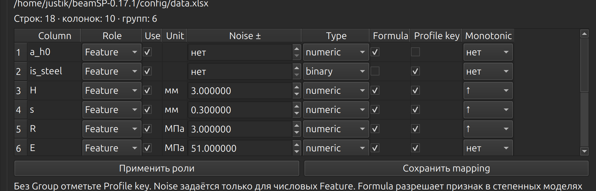

# Оганян Карина, 19.10:

В проекте уже был алгоритм **DE** (дифференциальная эволюция). Я добавила и исследовала ещё два подхода:
1-Log-Linear LS (лог-линейный МНК). Сначала логарифмируем степенную формулу, затем подбираем коэффициенты методом наименьших квадратов с ограничениями (BVLS).
2-LS + TRF. Сначала получаем коэффициенты с помощью LS, а потом TRF пытается их улучшить, уменьшая ошибки расчёта в кН.

Чтобы сравнение было честным, сначала я проверила все три метода в одинаковых условиях: 18 реальных строк + 270 синтетических, 6 проверок LOGO.

Первое сравнение — с исходной синтетикой

| Методика | Алгоритм | RMSE, кН      | R²      | Обучение 6 раз, с |
| ---------------- | ---------------- | --------------- | -------- | ----------------------------- |
| СП63           | DE               | **1,512** | 0,998684 | 1,392                         |
| СП63           | Log-Linear LS    | 1,689           | 0,998357 | 0,000754                      |
| СП63           | LS + TRF         | 6,475           | 0,975865 | 0,005923                      |
| РУК78         | DE               | 3,327           | 0,997461 | 1,389                         |
| РУК78         | Log-Linear LS    | **1,197** | 0,999671 | 0,001172                      |
| РУК78         | LS + TRF         | 6,226           | 0,991112 | 0,006184                      |

Получилось, что для СП63 DE оказался немного точнее обычного LS. Зато для РУК78 LS уменьшил RMSE с 3,327 до 1,197 кН и обучался намного быстрее в этих запусках. TRF с исходной синтетикой показал худшие результаты, хотя уменьшал ошибку на обучающих данных.

Также было проверено дополнительно:  тк на каждую реальную строку приходится 15 синтетических: в них немного меняются характеристики балки, а расчётная нагрузка остаётся прежней. Поэтому отдельно проверила влияние синтетики.

| Вариант обучения                        | RMSE СП63, кН           | RMSE РУК78, кН |
| ------------------------------------------------------ | --------------------------- | ------------------- |
| LS без синтетики                           | 0,210                       | 0,514               |
| TRF без синтетики                          | 0,143                       | **0,266**     |
| LS с небольшим весом синтетики | **0,107** (λ = 0,1) | 0,396 (λ = 0,25)   |

Те в наших экспериментах TRF лучше всего работал **без синтетики**, а LS иногда помогал небольшой её вес. Для TRF все проверенные положительные веса синтетики ухудшали результат относительно полного отказа от неё.

После сравнения были сделаны выводы:
LS оказался очень быстрым и точным для РУК78. С TRF сначала результаты были хуже, но дальнейшая проверка показала, что на него сильно влияет способ использования синтетических данных. Поэтому я не стала просто считать TRF неудачным, а проверила причину ухудшения.

Важно заметить, что показатели без синтетики и с её весами нельзя напрямую считать победой над DE, тк DE в этих режимах отдельно не проверялся.

# Галактионов Никита, 19.10:

обавил в программу функционал, что теперь можно в нее загружать не фиксированный датасет. Сделал это таким образом, что при загрузке нового датасета, пользователь сам определяет, что какие столбцы обозначают(на фотке как оно выглядит). Также сделал сохранение этих обозначений, чтобы каждый раз при запуске не надо было это делать

также пока что добавил такие новые методы в прогу, они обе степенные:
Log_Linear Least Squares
LogLinearLS + TRF
